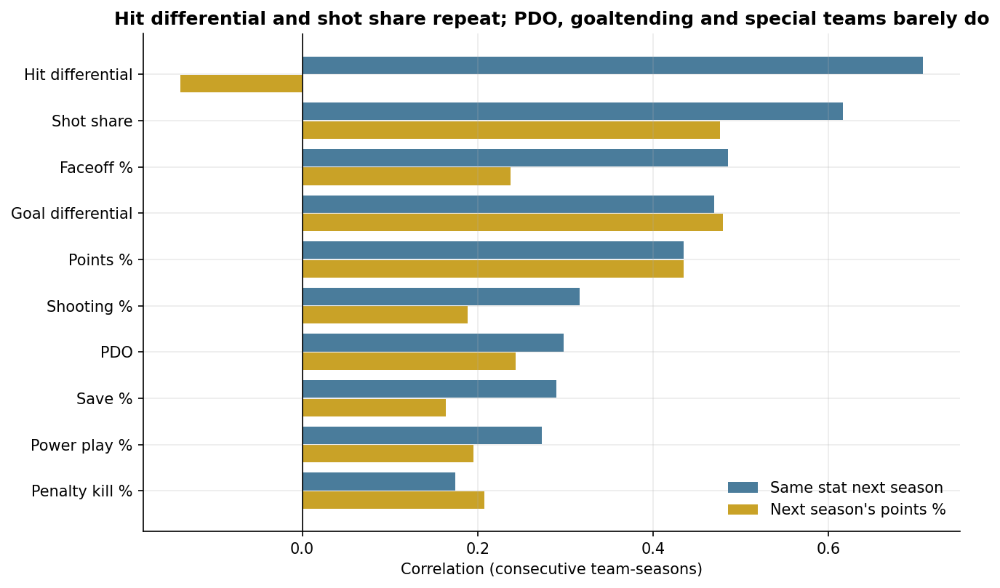
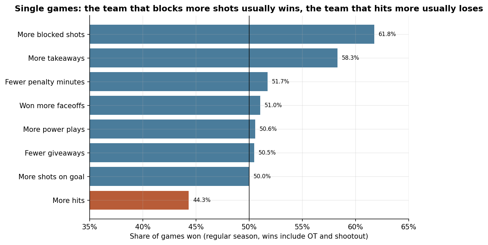
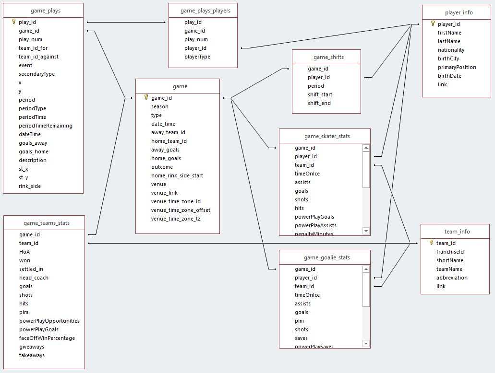

# NHL Player Analytics

An analysis of ten NHL seasons (2010-11 to 2019-20) built on the Kaggle NHL Game Data. So far the project turns the raw Kaggle files into a clean, tested set of tables and uses them to study what separates good teams from bad ones. Work on individual skaters, goalies, shot quality, home-ice advantage, hits and icing is in progress.

Everything runs locally in Python with DuckDB, which queries the CSV and Parquet files directly with SQL.

## Highlights

**Goal differential explains the standings almost completely.** Across the decade, a franchise's goals for minus goals against correlates 0.98 with its points percentage. Pittsburgh, Boston and Washington were the best regular-season teams; Buffalo and Edmonton were the worst. The top teams won in different ways: Boston and St. Louis allowed the fewest goals, while Tampa Bay and Vegas scored the most.

**Shooting and goaltending drive a single season, but they don't last.** Team shooting % plus save % (PDO) is the stat most closely tied to points % in a given season (0.76), yet it barely carries over to the next season (0.30). Shot share, a simple measure of puck possession, repeats much better (0.62) and predicts next season's points % at least as well as points % itself.



**Single-game box scores mislead because of the score.** A team that is ahead sits back and lets the other team shoot: in third periods, trailing teams take 58% of the shots. As a result, the team that outshoots its opponent wins exactly 50% of games, and the team that blocks more shots wins 62%. The team with more hits wins only 44%.



**Home scorekeepers are generous.** Home teams are credited with more takeaways in 63% of games and more giveaways on average, so stats counted by arena staff need adjusting before teams or players are compared.

**The league changed in 2017-18.** Scoring jumped from about 2.66 to 2.98 goals per team-game, driven by better finishing (shooting % rose from 9.0% to 9.5%) more than extra shots. Penalties fell steadily all decade, while power plays converted more often.

**Regular-season success is a weak guide to the Cup in any one year.** The team with the best record won the Stanley Cup only once in ten seasons (Chicago in 2012-13), and Los Angeles won in 2011-12 after finishing 13th. Over the whole decade, though, better regular-season franchises won far more playoff games (correlation 0.86).

**Mid-season coaching changes usually "worked", mostly through luck evening out.** Teams improved after 30 of 37 mid-season coaching changes, by a median of 11 percentage points of points %, but their shot share barely moved.

## Building a clean dataset

The Kaggle files needed a lot of work before they could be trusted. The audit and cleaning are in `phase1_data_audit_and_cleaning.ipynb`.

About 10% of the rows in every game-level table were exact duplicates, caused by roughly 2,570 games being loaded twice. No key had two conflicting versions, so the copies were dropped safely. Hits, blocks, takeaways, giveaways and playoff games are missing for every season before 2010-11, so the clean tables keep only the ten seasons from 2010-11 onward, where every stat is complete. Player experience is still measured over each player's full history back to 2000-01.

Several records were excluded or relabelled, each with a reason in `data/clean/reconciliation_log.csv`: All-Star exhibitions, "if necessary" playoff games that were never played, and twelve August 2020 qualifying-round games mislabelled as regular season. Shootout results were identified because the final score credits the winner with an extra goal that the player stats leave out. Eleven names belong to two different players (such as the two Sebastian Ahos), so every join uses player and team ids, never names.

The result was checked against the real NHL. Every season's game count matches the official schedule, including the shortened 2012-13 and 2019-20 seasons, and the 2016-17 totals for eight well-known players (McDavid, Crosby, Matthews and others) match NHL.com exactly.



| Table | One row per |
|---|---|
| `fact_game` | game, 2010-11 to 2019-20 (12,646 regular-season and playoff games) |
| `fact_team_game` | team per game, with the opponent's stats on the same row |
| `fact_player_game` | player per game, skaters and goalies (482,436 rows) |
| `fact_play` | play-by-play event, with rink coordinates |
| `bridge_play_player` | player role in a play (shooter, goalie, hitter, and so on) |
| `dim_player` | player |
| `dim_team` | team, with relocated franchises linked (Atlanta to Winnipeg, Phoenix to Arizona) |

## Team analysis

`eda/3a_teams.ipynb` covers a season-by-season recap of the league, team results and consistency over the decade, regular-season versus playoff success, which team stats go with winning (shooting and goaltending, shot share, special teams, faceoffs, puck possession and physical play), which of those stats repeat from year to year, and mid-season coaching changes. Each chart has the question it answers above it and a written finding below it. The charts are saved in `outputs/figures/3a_teams/`.

The analysis notebooks share one helper file, `eda/eda_utils.py`, which opens the clean tables and adds ready-made views for league averages by season, team franchises, and one row per skater or goalie per season. It also sets a common chart style and can draw an NHL rink for shot and hit maps.

## Repository layout

```
nhl_project/
├── phase1_data_audit_and_cleaning.ipynb   data audit, cleaning and the clean tables
├── eda/
│   ├── eda_utils.py                       shared setup for the analysis notebooks
│   └── 3a_teams.ipynb                     season recap and team analysis
├── data/
│   ├── raw/                               the Kaggle CSVs go here (not in the repo)
│   └── clean/                             clean tables written by the cleaning notebook
├── outputs/figures/                       charts, one folder per notebook
├── images/                                diagrams used in this README
└── requirements.txt
```

## Data

The project uses the [NHL Game Data](https://www.kaggle.com/datasets/martinellis/nhl-game-data) dataset by Martin Ellis on Kaggle. The data is not included in this repository.

## Running it yourself

The notebooks already contain the results from my run, so they can be read on GitHub without running anything. To reproduce them on a Mac with Anaconda and VS Code:

1. Open the `nhl_project` folder in VS Code and install the **Python** and **Jupyter** extensions when prompted.
2. In a terminal, create the environment:
   ```bash
   conda create -n nhl python=3.12 -y
   conda activate nhl
   pip install -r requirements.txt
   ```
3. Download the Kaggle CSVs into `data/raw/`, keeping their original names. `game_plays.csv` and `game_shifts.csv` are optional, but the play-by-play tables need `game_plays.csv`.
4. Open `phase1_data_audit_and_cleaning.ipynb`, choose the **nhl** kernel, and click **Run All**. It takes a few minutes and writes the clean tables to `data/clean/`.
5. Open any notebook in `eda/` and click **Run All**. These take a few seconds each.

The clean tables start at 2010-11. To include earlier seasons, change `ANALYSIS_START_SEASON` in the first code cell of the cleaning notebook, keeping in mind that hits, blocks, takeaways, giveaways and playoffs are not recorded before then.

If a notebook reports `No module named 'duckdb'`, it is using the wrong Python: select the **nhl** kernel again. If it reports that `game.csv is missing`, a required file isn't in `data/raw/` or was renamed by the browser (for example `game (1).csv`).
